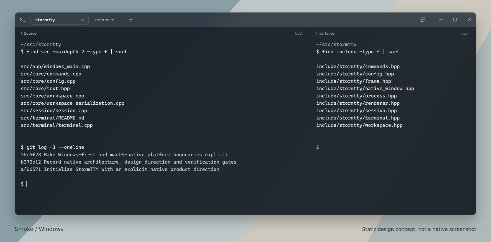

<h1 align="center">
  <picture>
    <source media="(prefers-color-scheme: dark)" srcset="docs/readme-assets/wordmark-dark.svg">
    
  </picture>
</h1>

<p align="center">A native terminal for Windows and macOS. Windows first.</p>

<p align="center">
  <a href="#why-stormtty">About</a> &nbsp; / &nbsp;
  <a href="#build-from-source">Build</a> &nbsp; / &nbsp;
  <a href="#using-the-windows-host">Controls</a> &nbsp; / &nbsp;
  <a href="#configuration">Configuration</a> &nbsp; / &nbsp;
  <a href="#roadmap">Roadmap</a>
</p>



<p align="center"><sub><strong>Smoke, a static design concept.</strong> A direction for the native interface, not a screenshot or evidence of runtime behavior.</sub></p>

> [!IMPORTANT]
> **StormTTY is in active development, not ready for daily use.** The Windows
> application is implemented and cross-links; native runtime qualification is
> still underway. There is no production release or supported binary download.
> See [platform status](#platform-status) before building.

## Why StormTTY?

StormTTY is being built for people who spend their day in a terminal: editing,
compiling, reviewing changes and running full-screen command-line applications.
The aim is a considered desktop application around that work, not another layer
between you and your shell.

- **A native application, not a browser surface.** Win32 windowing, ConPTY
  sessions, DirectWrite text and a Direct3D-backed renderer on Windows. The macOS
  target uses AppKit, CoreText, Metal and POSIX PTYs. No Electron or webview.
- **A workspace that keeps sessions intact.** Tabs and split panes share a
  portable workspace model. Reorder, resize, zoom and move panes without
  restarting their processes. The Windows host exposes these through commands
  and direct manipulation; cross-window tear-off is still planned.
- **An interface that leaves room for the terminal.** Integrated tabs, quiet
  dividers and no permanent sidebar. The Smoke direction adds slight
  background-only translucency: glyphs, the cursor and explicit terminal cell
  backgrounds stay opaque. Native visual qualification remains a separate gate.
- **Keyboard commands without stealing the shell's keys.** A searchable command
  palette and configurable bindings; `Ctrl+C` stays interrupt. Split and movement
  commands have no default shortcuts that would displace a TUI's bindings.
- **Compatibility has to survive the whole stack.** Terminal-state parsing is
  only part of the job. Input, PTY transport, resize, Unicode, synchronized output
  and graphics must work together, including demanding Ink applications.

The last point is a release requirement, not a claim that qualification is done.
The same applies to performance: there are [measurement plans and acceptance
criteria](docs/acceptance-gates.md), not published benchmark wins.

## Platform status

| Platform | Implementation | Verification boundary |
| --- | --- | --- |
| **Windows** | Native application, custom chrome, tabs, splits, command palette, ConPTY and DirectWrite/Direct3D renderer | Windows GNU executable and tests cross-link. Native MSVC execution, physical interaction and visual QA remain gates. |
| **macOS** | Shared core and POSIX PTY transport; AppKit/CoreText/Metal host in progress | Native build/runtime qualification is pending. No supported macOS application yet. |
| **Linux** | Portable core, terminal adapter, process and session test host | Core/process/session tests pass locally. A Linux desktop application is not a current product target. |

The [native workflow](.github/workflows/native.yml) separates Linux, Windows and
macOS evidence. A cross-compiled executable is not a Windows runtime pass; a CI
frame capture is not a test of physical input, desktop composition or
accessibility. Windows ARM64 and universal macOS packaging are not implied by an
x64 or single-architecture build.

## Build from source

Run these commands from the repository root. You need **Python 3.10+**, **Git**,
**CMake 3.24+** and a **C++20 compiler**. The Windows commands below also use Ninja.

The bootstrap builds the pinned terminal library, not Ghostty's application.
`--install-zig` explicitly opts into downloading the checksum-pinned Zig toolchain
inside this checkout. It does not install a system compiler or SDK. Sources,
artifacts and caches stay under `.deps/` and `.cache/` by default.

### Windows

Use an **x64 Native Tools Command Prompt for Visual Studio** with MSVC, the
Windows SDK and Ninja available:

```powershell
python tools/bootstrap.py --install-zig --prefix .deps/ghostty-native
cmake -S . -B build -G Ninja -DCMAKE_BUILD_TYPE=RelWithDebInfo -DSTORMTTY_GHOSTTY_ROOT=.deps/ghostty-native -DSTORMTTY_BUILD_APP=ON
cmake --build build --parallel 2
ctest --test-dir build --output-on-failure
.\build\stormtty.exe
```

The build copies the shared terminal library next to the executable. Keep them
together when running the development build. Do not substitute a Windows GNU
engine archive into an MSVC build; the import check rejects the ABI mismatch.

### macOS and Linux: core and PTY tests

On macOS, install Xcode Command Line Tools first; `xcrun --show-sdk-path` must
succeed. On Linux, use a native C++20 toolchain.

```sh
python3 tools/bootstrap.py --install-zig --prefix .deps/ghostty-native
cmake -S . -B build -DCMAKE_BUILD_TYPE=RelWithDebInfo -DSTORMTTY_GHOSTTY_ROOT=.deps/ghostty-native -DSTORMTTY_BUILD_APP=OFF
cmake --build build --parallel 2
ctest --test-dir build --output-on-failure
```

This builds the shared libraries and tests, not a desktop application. The macOS
native host is a separate, in-progress integration.

For an existing Zig installation, custom caches, offline builds, target selection
and cross-compilation, see the [bootstrap guide](tools/bootstrap.README.md).
Dependency revisions and archive hashes live in
[`tools/bootstrap.lock.json`](tools/bootstrap.lock.json).

## Using the Windows host

The development host starts Command Prompt by default. Profiles can select a
different shell; StormTTY does not replace or emulate the shell itself.

| Action | Default shortcut |
| --- | --- |
| Show commands | `Ctrl+Shift+P` |
| New tab | `Ctrl+Shift+T` |
| Close active pane | `Ctrl+Shift+W` |
| Next / previous tab | `Ctrl+Tab` / `Ctrl+Shift+Tab` |
| Copy selection | `Ctrl+Shift+C` |
| Paste | `Ctrl+Shift+V` |
| Windows system menu | `Alt+Space` |

Use **Show commands** for splits, pane focus and movement, pane zoom, tab
renaming, split equalization and fullscreen. The command palette also shows
unavailable actions with a reason. Find-in-terminal and the in-app settings
editor are not implemented yet; their reserved command IDs are not evidence of
working features.

The [command registry](src/core/commands.cpp) defines the full set of actions and
platform-specific bindings. Close and paste behavior still need native
interaction testing; do not use the development build for irreplaceable work.

## Configuration

The Windows host reads `%LOCALAPPDATA%\StormTTY\config.stormtty` if it exists.
To use a different file, launch `stormtty.exe --config path\to\config.stormtty`.
There is no settings-file generator or in-app editor yet; create the file
manually and restart the application after changes.

A small, complete configuration:

```ini
version = 1

[appearance]
background_opacity = 0.94
backdrop = "auto"
reduced_motion = "system"

[font]
family = "Cascadia Mono"
size_dip = 14

[terminal]
scrollback_lines = 10000

[bindings.windows]
pane.split_right = "Ctrl+Shift+D"
pane.split_down = "Ctrl+Shift+E"
pane.zoom = "Ctrl+Shift+Z"
```

This is **StormTTY's declarative format, not general TOML**. Unknown keys,
duplicate assignments and conflicting shortcuts are errors. There are no
includes, scripts, environment expansion or shell expressions. An invalid
startup file is rejected rather than partially applied.

`background_opacity` accepts `0.70` through `1.0` and affects only the default
terminal background. `backdrop = "none"` opts out of the backdrop; high-contrast
and unsupported rendering paths use an opaque background. Font names refer to
available fonts; the current development build does not bundle Cascadia Mono.

For a custom shell, add a profile with a separate executable and argument list.
Use an installed executable's full path, and escape Windows backslashes as `\\`.
See [`config_format_documentation()`](src/core/config.cpp) for the complete
format, themes, profiles, environment entries and binding rules. Unspecified
settings retain their defaults.

## Architecture

StormTTY owns the application and platform integration. It reuses
[Ghostty's `libghostty-vt`](https://github.com/ghostty-org/ghostty) for terminal
parsing and state through its public C API. It is not a port of Ghostty's GUI,
and upstream terminal features still need end-to-end qualification in this host.

```text
Native window and input
          │
Commands, configuration and workspace
          │
       Session ────────── ConPTY / POSIX PTY ───── Shell or TUI
          │
 Terminal adapter ─────── libghostty-vt
          │
    Owned frame
          │
DirectWrite + Direct3D / CoreText + Metal
```

The C++20 core does not own window-system handles. Platform adapters own native
windowing, process transport, input, clipboard integration and presentation.
The terminal adapter publishes owned frames rather than retaining borrowed
Ghostty data across mutations or threads. The Windows renderer uses one
compositor surface per window, not a separate swapchain for every pane.

| Area | Start here |
| --- | --- |
| Workspace, commands and configuration | [`src/core/`](src/core/) |
| PTY/session coordination | [`src/session/`](src/session/) |
| Terminal adapter and upstream boundary | [`src/terminal/`](src/terminal/) |
| Native hosts and renderers | [`src/platform/`](src/platform/) |
| Foundation and platform decisions | [`docs/decisions/`](docs/decisions/) |
| Release criteria and adversarial cases | [`docs/acceptance-gates.md`](docs/acceptance-gates.md) |

The pinned Ghostty revision is
[`46e9dc9a927b`](https://github.com/ghostty-org/ghostty/commit/46e9dc9a927b2e7e7cba79e6902c176127dbdf2c).
Its work and authorship remain upstream; the
[dependency audit](docs/decisions/ghostty-audit.md) records the integration choice.

## Roadmap

The next milestone is a reproducibly tested native application, not a longer
feature list.

| Work | State | What still needs to be established |
| --- | --- | --- |
| Shared workspace, commands, config, terminal adapter and sessions | Implemented; portable tests pass | Broader regression and adversarial coverage |
| Windows native application | Implemented; cross-link checks pass | MSVC/runtime evidence, desktop visual QA, DPI, Snap and interaction checks |
| macOS application | In progress | Native AppKit/Metal integration and runtime evidence |
| Modern terminal and Ink workloads | Qualification pending | Resize, Unicode, input, synchronized output and graphics across the complete native path |
| Text input and accessibility | Incomplete | Full TSF/IME and UI Automation behavior, screen-reader and physical-input testing |
| Find, settings editor and cross-window tear-off | Planned | User-facing implementation and tests |
| Performance and distribution | Pending | Recorded-hardware measurements, ConPTY provider qualification, packaging and complete notices |

See the [acceptance gates](docs/acceptance-gates.md) for the detailed test matrix.
Proposed latency and memory budgets there are targets, not results.

## Testing and contributing

Small changes with a reproducible test are especially useful at this stage.
Include the OS, architecture, compiler, dependency revision and exact commands
in a bug report. For terminal behavior, provide the smallest byte sequence or
program that reproduces it, plus expected and actual output. Remove credentials,
private paths and shell history from logs and captures before sharing them.

Run the native CMake tests above and the bootstrap boundary checks:

```sh
python3 tools/bootstrap_tests.py -v
```

On Windows, the opt-in development smoke mode runs a controlled ConPTY session
and can save its renderer framebuffer:

```powershell
.\build\stormtty.exe --smoke --capture frame.png
```

Smoke mode does not read user configuration or profile scripts. A framebuffer
capture cannot establish desktop-composited translucency, IME behavior,
screen-reader support or human-perceived latency. Use the
[window](tests/window_verification.md) and
[renderer](tests/renderer_verification.md) checklists for those boundaries.

Keep platform code out of the portable core, preserve upstream notices and avoid
unrelated changes. A new capability needs a test at the layer that actually
implements it; a parser test alone cannot qualify a native UI feature.

### Security

Terminal output is untrusted input. Titles, hyperlinks, clipboard requests and
images must not become implicit permission to execute commands or access local
resources. Application-requested clipboard reads and writes are denied by the
current adapter; explicit user copy/paste is a separate path. Resource limits
and malformed-input behavior remain part of the release review, not a claim of
a completed security audit.

Do not include secrets or weaponized payloads in public reports. A dedicated
private security-reporting channel has not yet been established.

## Licensing and acknowledgments

**A license for the original StormTTY application code has not yet been
selected.** Do not assume that the upstream engine's license applies to the
whole repository or grants redistribution rights for the application.

`libghostty-vt` is part of the MIT-licensed Ghostty project. Its
[copyright and license notice](docs/decisions/GHOSTTY-LICENSE.txt) is retained
here and by the bootstrap. Binary distribution still requires an audit of all
included dependencies and artifact-specific notices.

Thanks to the Ghostty contributors for the terminal engine this project builds
on. StormTTY's native application, integration choices and verification claims
are its own responsibility.
