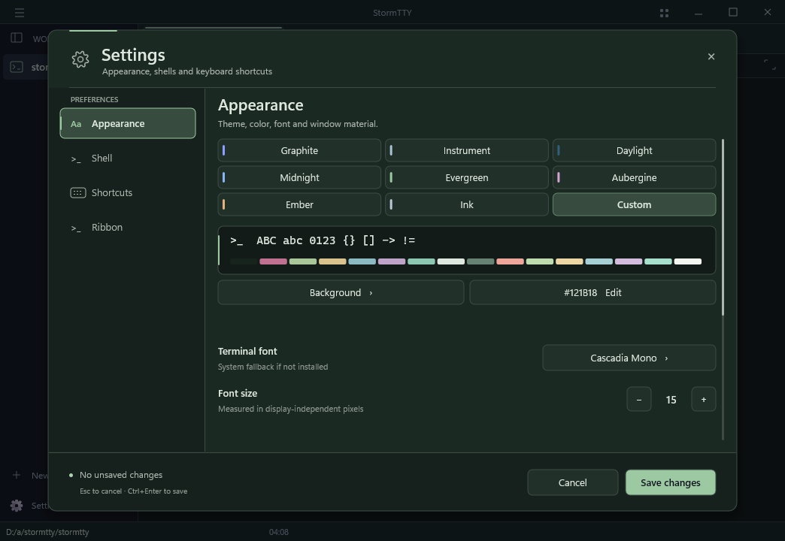
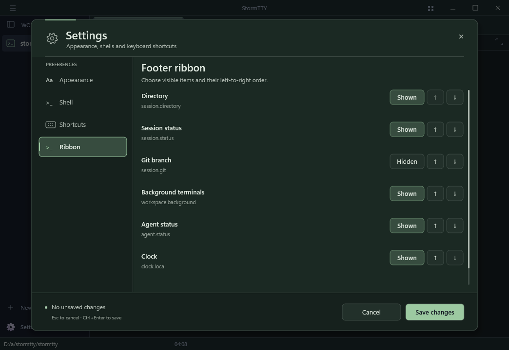

<h1 align="center">
  <picture>
    <source media="(prefers-color-scheme: dark)" srcset="docs/readme-assets/wordmark-dark.svg">
    
  </picture>
</h1>

<p align="center">A native terminal built around your workspaces. Windows first; macOS in progress.</p>

<p align="center">
  <a href="#why-stormtty">About</a> &nbsp; / &nbsp;
  <a href="#workspaces-that-outlast-a-window">Workspaces</a> &nbsp; / &nbsp;
  <a href="#codex-with-a-native-place-to-work">Codex</a> &nbsp; / &nbsp;
  <a href="#build-from-source">Build</a> &nbsp; / &nbsp;
  <a href="#using-the-windows-host">Controls</a> &nbsp; / &nbsp;
  <a href="#configuration">Configuration</a> &nbsp; / &nbsp;
  <a href="#roadmap">Roadmap</a>
</p>

> [!IMPORTANT]
> **StormTTY is in active development, not ready for daily use.** The Windows
> application builds with MSVC and its native UI checks run successfully;
> the full suite still has known compatibility failures. Physical interaction
> and visual qualification are also underway. There is no production release
> or supported binary download.
> See [platform status](#platform-status) before building.

## Why StormTTY?

A terminal window rarely contains just one task. There is an editor in one
pane, a build running somewhere else, a shell you want to keep, and another
project waiting its turn. StormTTY gives that work a place without turning the
terminal into a browser application.

The Windows host is Win32, ConPTY, DirectWrite and Direct3D. Terminal state comes
from Ghostty's pinned `libghostty-vt` C API; the workspace model, native controls,
process ownership and rendering integration belong to StormTTY. No Electron,
webview or embedded Node runtime is needed for the application.

### Workspaces that outlast a window

Each project has its own tabs, split layout and background terminals. Switching
projects does not restart hidden sessions. Parking a pane moves its **existing
process** to the footer; restoring it brings back the same terminal document,
including retained output after that process exits.

Windows also saves the arrangement: project order, active selection, names,
icons, accents, launch folders, preferred shells, tab titles, split ratios,
focus and zoom. Save a named set and open another copy alongside your current
work—opening a preset does not close what is already running.

There is an important distinction between **keeping work alive** and **restoring
its layout**. Across an application restart, shells are fresh processes. Commands,
output, credentials and background jobs are not replayed. The selected workspace
starts its restored panes first; hidden workspaces wait until selected. Missing
profiles or folders leave a visible problem rather than silently substituting a
shell or directory. [Persistence and recovery details →](docs/workspace-presets.md)

### A quieter frame, with controls that belong to it

Tabs, dividers, menus, Settings and the command palette share the native renderer.
The footer ribbon can show directory, Git, session status, background terminals,
agent status and a clock. Reorder or hide its six built-in items in Settings;
preview is immediate, Cancel restores the old arrangement, and Save persists it.
Errors and agent attention cannot be hidden by customization. This is a small
closed set of data bindings, not an executable plugin system.

Appearance has eight complete palettes: **Graphite, Instrument, Daylight,
Midnight, Evergreen, Aubergine, Ember and Ink**. A Custom palette edits the canvas,
text, chrome, accent and all sixteen ANSI colors, with a native preview and hex
editor. Explicit truecolor output and application OSC palette overrides retain
their meaning; the theme does not recolor everything a TUI draws.

Windows materials are equally explicit: solid, Mica or Acrylic where available,
with opacity applied only to the default terminal background. Text and explicit
cell backgrounds stay opaque. **Windows controls the blur kernel; there is no
adjustable blur-radius feature.** The UI reports fallback instead of pretending
a requested material is active. [Themes](docs/theme-library.md) ·
[Ribbon](docs/footer-ribbon.md)

<p align="center">
  
</p>

<details>
<summary>Arrange the footer ribbon</summary>



</details>

These are native Windows development-build captures from the automated fixture,
not concept art. They show layout and controls; desktop blur and physical input
latency need separate hardware verification.

### Codex with a native place to work

The first Codex integration is implemented as a Windows-native panel, not an
embedded TUI or a webview. `Ctrl+Shift+J` opens it; Escape returns focus to the
terminal. Drafts and views belong to durable workspace identities. Transcript,
scoped approval requests, diff evidence and failures use native controls, while a
separate app-server adapter owns structured JSONL communication.

The boundary is deliberate:

- **Finds your installation.** Opening the panel checks supported native and npm
  installation locations and starts a status-only app-server. No path or email
  entry is needed for the normal flow. Missing Codex? Open the official install
  guide, install it yourself, then retry. Advanced path overrides remain optional.
- **Guided sign-in.** Your existing ChatGPT sign-in is read from Codex. If signed
  out, choose Sign in, then Continue in browser; Codex owns the official login
  and credentials. StormTTY never asks for passwords, tokens or API keys.
- **Connection is not a task.** Opening the panel or signing in never submits a
  prompt. Review start → Start task separately confirms the workspace and
  execution scope. An unknown Advanced executable requires Connect confirmation.
  See the [onboarding contract](docs/codex-onboarding.md) for discovery and auth limits.
- **A restricted first slice.** The service checks account identity and the
  returned policy before starting: read-only sandbox, network disabled, untrusted
  command approval policy and user review. Unsupported account identities or
  permission scopes fail visibly; there is no blanket accept-for-session action.
- **No silent replay.** Reopening a view or restoring a workspace sends no prompt.
  Disconnects do not retry a turn, and stale approvals cannot authorize new work.

The native panel and real stdio transport have authored offline fixtures.
**Live Codex authentication, inference and sandbox behavior are not qualified.**
Agent conversation associations are not yet wired into the native workspace save
file; do not expect cross-restart conversation restoration. macOS agent UI and a
Claude provider are not implemented. Setup and exact verification boundaries are
in the [native panel guide](docs/verification/native-agent-panel.md) and
[protocol contract](docs/decisions/codex-app-server-contract.md).

Compatibility still has to survive the entire terminal stack: input, PTY
transport, resize, Unicode, synchronized output and graphics. New workspace or
agent features do not waive those requirements. The [acceptance gates](docs/acceptance-gates.md)
contain measurement plans and targets, not published benchmark wins.

## Platform status

| Platform | Implementation | Verification boundary |
| --- | --- | --- |
| **Windows** | Native application, custom chrome, tabs, splits, command palette, ConPTY and DirectWrite/Direct3D renderer | Native MSVC build passes. Session, terminal and renderer tests execute on Windows; full-suite qualification, physical interaction and visual QA remain gates. |
| **macOS** | Shared core, POSIX PTY transport and AppKit/CoreText/Metal host | Native compilation, core/PTY and offscreen renderer checks pass. Onscreen presentation verification remains unresolved; no supported macOS application yet. |
| **Linux** | Portable core, terminal adapter, process and session test host | Core/process/session tests pass locally. A Linux desktop application is not a current product target. |

The [native workflow](.github/workflows/native.yml) separates Linux, Windows and
macOS evidence. Its automatic baseline and separate strict, manual compatibility
qualification are documented in [CI coverage](docs/ci-coverage.md). A cross-compiled executable is not a Windows runtime pass; a CI
frame capture is not a test of physical input, desktop composition or
accessibility. Windows ARM64 and universal macOS packaging are not implied by an
x64 or single-architecture build.

### Windows console backend preview

Windows AMD64 app builds privately bundle pinned Microsoft ConPTY
`1.25.260930003`; **System is still the default**. In Settings → Shell, choose
**Bundled (preview)** and Save to use it for new tabs and panes. Existing sessions
are never restarted. Switch back to System the same way. No launch flags,
system installation, global PATH changes or launch-time downloads are required.
The compact-alt resize regression remains unresolved; this is not a full Ink or
graphics compatibility claim. See [bundling, recovery and verification](docs/bundled-console.md).

## Build from source

Run these commands from the repository root. You need **Python 3.10+**, **Git**,
**CMake 3.24+** and a **C++20 compiler**. The Windows commands below also use Ninja;
use **Python 3.12+** there for the bundled-shell staging tools.

The bootstrap builds the pinned terminal library, not Ghostty's application.
`--install-zig` explicitly opts into downloading the checksum-pinned Zig toolchain
inside this checkout. It does not install a system compiler or SDK. Sources,
artifacts and caches stay under `.deps/` and `.cache/` by default.

### Windows

Use an **x64 Native Tools Command Prompt for Visual Studio** with MSVC, the
Windows SDK and Ninja available:

```powershell
python tools/bootstrap.py --install-zig --prefix .deps/ghostty-native
cmake -S . -B build-msvc -G Ninja -DCMAKE_CXX_COMPILER=cl -DCMAKE_BUILD_TYPE=RelWithDebInfo -DSTORMTTY_GHOSTTY_ROOT=.deps/ghostty-native -DSTORMTTY_BUILD_APP=ON
cmake --build build-msvc --parallel 2
ctest --test-dir build-msvc --output-on-failure
.\build-msvc\stormtty.exe
```

Use a fresh build directory when changing compilers. CMake caches its first compiler
selection; a previously configured `build` directory may still select an older LLVM
installation even inside a Visual Studio prompt. The explicit `cl` selection above
uses the compiler matching the installed MSVC headers. Do not disable STL version
checks or edit Visual Studio headers to work around a compiler mismatch.

The build copies the shared terminal library next to the executable. Keep them
together when running the development build. Do not substitute a Windows GNU
engine archive into an MSVC build; the import check rejects the ABI mismatch.

### macOS: native development build

Install Xcode Command Line Tools and Homebrew's `llvm@20`. Apple's libc++ in
Xcode 16.4 does not expose the standard cancellation APIs used by the session
layer. The supplied toolchain uses LLVM 20's compiler, headers and matching
runtime together; substituting headers alone is not sufficient.

```sh
brew install llvm@20
python3 tools/bootstrap.py --install-zig --prefix .deps/ghostty-native
cmake -S . -B build-macos -G Ninja -DCMAKE_TOOLCHAIN_FILE=cmake/MacOSLLVM.cmake -DSTORMTTY_LLVM_ROOT="$(brew --prefix llvm@20)" -DCMAKE_BUILD_TYPE=RelWithDebInfo -DSTORMTTY_GHOSTTY_ROOT=.deps/ghostty-native -DSTORMTTY_BUILD_APP=ON
cmake --build build-macos --parallel 2
ctest --test-dir build-macos --output-on-failure
open build-macos/stormtty.app
```

Native build and offscreen checks are narrower than a qualified desktop app.
The application is not a self-contained distribution: its Ghostty and LLVM
runtime dependencies still need audited packaging. macOS 11 is the source API
baseline, not a verified minimum OS for the Homebrew-built runtime. See the
[macOS implementation notes](src/platform/macos/README.md).

### Linux: core and PTY tests

Use a native C++20 toolchain. Linux does not have an application host.

```sh
python3 tools/bootstrap.py --install-zig --prefix .deps/ghostty-native
cmake -S . -B build -DCMAKE_BUILD_TYPE=RelWithDebInfo -DSTORMTTY_GHOSTTY_ROOT=.deps/ghostty-native -DSTORMTTY_BUILD_APP=OFF
cmake --build build --parallel 2
ctest --test-dir build --output-on-failure
```

For an existing Zig installation, custom caches, offline builds, target selection
and cross-compilation, see the [bootstrap guide](tools/bootstrap.README.md).
Dependency revisions and archive hashes live in
[`tools/bootstrap.lock.json`](tools/bootstrap.lock.json).

## Using the Windows host

Fresh Windows app builds start managed Zsh by default. Existing saved shell
choices are preserved, and Settings can select another installed shell.
StormTTY hosts the shell; its terminal engine does not interpret shell commands.

| Action | Default shortcut |
| --- | --- |
| Show commands | `Ctrl+Shift+P` |
| Open Codex panel | `Ctrl+Shift+J` |
| New tab | `Ctrl+Shift+T` |
| Close active pane | `Ctrl+Shift+W` |
| Next / previous tab | `Ctrl+Tab` / `Ctrl+Shift+Tab` |
| Copy selection | `Ctrl+Shift+C` |
| Paste | `Ctrl+Shift+V` |
| Window menu | `Alt+Space` |

`Ctrl+C` remains the shell's interrupt. Split and pane-movement commands have
no default bindings that would displace a TUI's keys. Use **Show commands** for splits, pane focus and movement, pane zoom, tab
renaming, split equalization and fullscreen. The command palette also shows
unavailable actions with a reason. Select an action and press **Alt+Enter** to
assign and save its shortcut. Conflicts and OS-reserved shortcuts are rejected. Terminal keys such as `Alt+]`
require **Use shortcut** confirmation before they can override shell input.

Choose **Move to background** in the pane menu or command palette to park a
terminal in its workspace's footer without restarting its process. Click its
footer chip to restore it; right-click for actions, including confirmed close.
The overflow menu holds additional background terminals. Parking the last pane
leaves **New terminal** available. Exit indicators report the terminal process's
exit code—not command readiness or service health. Background sessions are not
restored after restarting StormTTY.

**Settings** brings together the eight built-in themes, Custom palette editing,
font and material controls, ribbon arrangement, shell selection and shortcuts. Cancel restores
the original palette; Save persists it. Existing terminal applications keep
their own OSC color overrides and explicit ANSI/RGB colors. The Windows host
retains bounded terminal output after process exit for scrolling, selection,
copying and resize until the terminal is closed. Close confirmations, context menus and settings share the
app's renderer-owned interface. Find-in-terminal has a tested core search service,
but its user-facing command is not enabled yet.

The [command registry](src/core/commands.cpp) defines the full set of actions and
platform-specific bindings. Close and paste behavior still need native
interaction testing; do not use the development build for irreplaceable work.

### Bundled Zsh on Windows

The Windows build bundles upstream **Zsh 5.9.2**, a managed startup preset and
pinned source modules—not a fork of Zsh or an installation into your existing
shell environment. The preset includes:

- Real **Oh My Zsh** completion, key-binding, history and supporting libraries,
  plus **zsh-autosuggestions** and **zsh-syntax-highlighting**.
- A two-line prompt with directory, branch/detached HEAD, exit status and elapsed
  time. Its bounded Git metadata reader does not run Git or scan the worktree on
  every prompt.
- Bundled **fzf** completion/key bindings and **zoxide** navigation. Their managed
  integration can be disabled; `z` and `zi` do not replace `cd` or existing user
  commands. The runtime also includes `awk` for the shipped shell tools.
- Bounded history and completion caches in native-validated, account-local state.
  If that state is unavailable or untrusted, the modules remain usable in an
  explicitly nonpersistent mode.

Your existing HOME, launch directory, global PATH and shell dotfiles remain
separate. On Windows, managed state lives under
`%LOCALAPPDATA%\StormTTY\managed-zsh-v1`; an optional user-created `config.zsh`
there is the managed customization point. The loader does not create a config
for you or read your global `.zshrc`. History can contain secrets—keep it out of
bug reports. This bundle is not a plugin manager, marketplace or automatic updater.

**Build the `stormtty` target, then Run.** The first Windows app build fetches
checksum-pinned dependencies into its private cache and stages `runtimes/zsh`
beside the executable. It does not require a manual shell-download step or
`--shell-runtime` launch arguments. Subsequent builds reuse the cache. Downloads
happen at build time, never when opening a terminal, and no global PATH, shell
installation or user dotfile is changed.

- **Fresh configuration:** managed Zsh is selected automatically.
- **Existing saved configuration:** your shell choice wins. Open Settings → Shell,
  choose **Zsh · managed**, and Save once. New tabs/panes use it; existing processes
  keep running. Only a stable profile reference is saved, not an installation
  directory or a copy of your PATH.
- **Moving the app:** keep `runtimes/zsh` beside the executable. Rebuilding repairs
  a missing staged runtime. If managed Zsh is selected but unavailable, the app
  reports an error instead of silently running another shell. An unrelated saved
  shell remains usable.

Core-only and non-Windows builds do not fetch this Windows runtime. Downstream
Windows builds can explicitly set `-DSTORMTTY_BUNDLE_ZSH=OFF`. An already staged
runtime can be supplied with `-DSTORMTTY_DEVELOPER_SHELL_RUNTIME=<absolute-root>`;
that is an advanced offline override, not a required setup step. No IDE-specific
project files are needed.

Native Windows CI has exercised both inbox and packaged-console Zsh probes:
interactive/native handles, Unicode and working directories, Ctrl-C,
suspend/background/foreground jobs, and exit status. App-with-Zsh smoke checks
pass, including normal launches without a shell-runtime flag. Resize qualification
remains intermittent: the native console can report the new grid while Zsh still
reports the previous dimensions, and an input-loss case has also been observed.
Compact alternate-screen Ink layouts retain a separate resize-redraw failure.
The full Windows suite is not green; passing CI smoke checks are not physical
keyboard/UI qualification.

The bundled Microsoft console backend is a separate Settings → Shell preview;
System remains the default. `--console-runtime <absolute-directory>` is an
advanced explicit override, not the normal way to enable the preview. Bundling
Zsh does not replace Windows system files or silently select another backend.

Module persistence and editing have dedicated
[native qualification probes](docs/managed-zsh-qualification.md); fzf/zoxide have
separate [integration and source-closure limits](tools/shell-tools.README.md).
Those gates are not interchangeable with a successful base-shell launch, and
startup measurements are not general latency claims.

The build retains upstream notices. Public redistribution additionally needs an
accessible matching source download and completion of the tools' linked-source
review. See the [distribution packet guide](tools/shell-notices/REVIEW.md),
[runtime staging guide](tools/shell-bootstrap.README.md) and
[console compatibility evidence](tests/ink/conpty-el-regression/README.md).

## Configuration

The Windows host reads `%LOCALAPPDATA%\StormTTY\config.stormtty` if it exists.
To use a different file, launch `stormtty.exe --config path\to\config.stormtty`.
Use **Settings** to edit and save supported options. Reopening Settings reads
valid external edits without requiring a restart. Cancel restores the running
appearance; Save adopts the editor’s settings, including shell and shortcuts. Appearance previews can be cancelled; changing the default shell
applies to new sessions, not processes already running. Saving detects external
file changes rather than silently overwriting them.

A small, complete configuration:

```ini
version = 1

[appearance]
background_opacity = 0.94
backdrop = "auto"
reduced_motion = "system"

[font]
family = "Cascadia Mono"
size_dip = 14

[terminal]
scrollback_lines = 10000

[bindings.windows]
pane.split_right = "Ctrl+Shift+D"
pane.split_down = "Ctrl+Shift+E"
pane.zoom = "Ctrl+Shift+Z"
```

This is **StormTTY's declarative format, not general TOML**. Unknown keys,
duplicate assignments and conflicting shortcuts are errors. There are no
includes, scripts, environment expansion or shell expressions. An invalid
startup file is rejected rather than partially applied.

`background_opacity` accepts `0.0` through `1.0` and affects only the default
terminal background. On supported Windows builds, `backdrop = "auto"` requests
Desktop Acrylic; `"mica"` explicitly selects wallpaper-based Mica and `"none"`
selects a solid background. Appearance shows the requested material or the
current fallback reason. Saved opacity is preserved; 100% covers the material.
Windows can substitute a solid surface for inactive windows, accessibility,
power or graphics conditions ([Microsoft's material guidance](https://learn.microsoft.com/en-us/windows/apps/design/style/acrylic)).
Cascadia Mono is bundled; other font names refer to installed fonts.

For a custom shell, add a profile with a separate executable and argument list.
Use an installed executable's full path, and escape Windows backslashes as `\\`.
See [`config_format_documentation()`](src/core/config.cpp) for the complete
format, themes, profiles, environment entries and binding rules. Unspecified
settings retain their defaults.

## Architecture

StormTTY owns the application and platform integration. It reuses
[Ghostty's `libghostty-vt`](https://github.com/ghostty-org/ghostty) for terminal
parsing and state through its public C API. It is not a port of Ghostty's GUI,
and upstream terminal features still need end-to-end qualification in this host.

```text
Native window and input
          │
Commands, configuration and workspace
          │
       Session ────────── ConPTY / POSIX PTY ───── Shell or TUI
          │
 Terminal adapter ─────── libghostty-vt
          │
    Owned frame
          │
DirectWrite + Direct3D / CoreText + Metal
```

Agent work takes a separate path: native panel → workspace-qualified controller
→ `AgentService` → app-server stdio. It never enters the PTY parser, and terminal
escape sequences cannot start a task or grant an approval.

The C++20 core does not own window-system handles. Platform adapters own native
windowing, process transport, input, clipboard integration and presentation.
The terminal adapter publishes owned frames rather than retaining borrowed
Ghostty data across mutations or threads. The Windows renderer uses one
compositor surface per window, not a separate swapchain for every pane.

| Area | Start here |
| --- | --- |
| Workspace, commands and configuration | [`src/core/`](src/core/) |
| Structured Codex service and native stdio transport | [`src/agent/`](src/agent/) |
| PTY/session coordination | [`src/session/`](src/session/) |
| Terminal adapter and upstream boundary | [`src/terminal/`](src/terminal/) |
| Native hosts and renderers | [`src/platform/`](src/platform/) |
| Foundation and platform decisions | [`docs/decisions/`](docs/decisions/) |
| Release criteria and adversarial cases | [`docs/acceptance-gates.md`](docs/acceptance-gates.md) |

The pinned Ghostty revision is
[`46e9dc9a927b`](https://github.com/ghostty-org/ghostty/commit/46e9dc9a927b2e7e7cba79e6902c176127dbdf2c).
Its work and authorship remain upstream; the
[dependency audit](docs/decisions/ghostty-audit.md) records the integration choice.

## Roadmap

The next milestone is a reproducibly tested native application, not a longer
feature list.

| Work | State | What still needs to be established |
| --- | --- | --- |
| Shared workspace, commands, config, terminal adapter and sessions | Implemented; portable tests pass | Broader regression and adversarial coverage |
| Windows native application | Native MSVC build passes; session and renderer tests pass | Complete native regression suite, desktop visual QA, DPI, Snap and interaction checks |
| macOS application | Native build, core/PTY and offscreen renderer checks pass | Verified onscreen presentation, physical input and platform UI parity |
| Modern terminal and Ink workloads | Packaged Windows console fixes the verified right-margin defect | Compact alternate-screen resize race; broader graphics/protocol coverage |
| Text input and accessibility | Incomplete | Full TSF/IME and UI Automation behavior, screen-reader and physical-input testing |
| Themes, ribbon, shortcuts and owned menus | Windows controls and portable validation implemented; native fixture coverage | Desktop material checks, physical interaction, accessibility and platform parity |
| Saved workspaces | Windows persistence, named sets and additive restore implemented | Continued restart/recovery regression coverage; macOS host wiring |
| Native Codex first slice | Windows panel, consent flow and native stdio adapter implemented; offline fixtures | Separately authorized live-provider qualification; conversation-store wiring; macOS UI |
| Managed Zsh and modules | Bundled runtime, OMZ/editing modules, private state and fzf/zoxide integration | Module/tool-specific native gates, linked-source review, public packaging and physical interaction |
| Find and cross-window tear-off | Core search implemented; UI/tear-off pending | User-facing implementation and native tests |
| Performance and distribution | Pending | Recorded-hardware measurements, ConPTY provider qualification, packaging and complete notices |

The first Codex slice establishes the transport, consent and native-view seams;
it is not a claim of a finished agent workspace. A Claude adapter, richer history
and broader execution modes require their own protocol and permission design.

See the [acceptance gates](docs/acceptance-gates.md) for the detailed test matrix.
Proposed latency and memory budgets there are targets, not results.

## Ink workload checks

An optional qualification target runs a pinned, real Ink/React application through
StormTTY's PTY and session pipeline. It covers changing animation frames, input,
paste, Unicode and resize, and refuses a noninteractive fallback. The initial
Linux run passes. Native Windows tests distinguish the inbox and explicit
packaged console providers; the latter resolves the captured right-margin
incompatibility, but repeated compact alternate-screen resizing still fails in
some runs. macOS also has a compact-layout resize regression. One fixture is not
a claim that every Ink application works.

```sh
npm ci --prefix tests/ink --ignore-scripts --no-audit --no-fund
npm test --prefix tests/ink
```

Use Node 22 or newer and add `-DSTORMTTY_TEST_INK=ON` to your CMake configuration.
The normal desktop build does not require Node. See the
[verification record](tests/ink_verification.md) for commands, evidence and resize
limitations.

## Testing and contributing

Small changes with a reproducible test are especially useful at this stage.
Include the OS, architecture, compiler, dependency revision and exact commands
in a bug report. For terminal behavior, provide the smallest byte sequence or
program that reproduces it, plus expected and actual output. Remove credentials,
private paths and shell history from logs and captures before sharing them.

Run the native CMake tests above and the bootstrap boundary checks:

```sh
python3 tools/bootstrap_tests.py -v
```

On Windows, the opt-in development smoke mode runs a controlled ConPTY session
and can save its renderer framebuffer:

```powershell
.\build-msvc\stormtty.exe --smoke --capture frame.png
```

Smoke mode does not read user configuration or profile scripts. A framebuffer
capture cannot establish desktop-composited translucency, IME behavior,
screen-reader support or human-perceived latency. Use the
[window](tests/window_verification.md) and
[renderer](tests/renderer_verification.md) checklists for those boundaries.

Keep platform code out of the portable core, preserve upstream notices and avoid
unrelated changes. A new capability needs a test at the layer that actually
implements it; a parser test alone cannot qualify a native UI feature.

### Security

Terminal output is untrusted input. Titles, hyperlinks, clipboard requests and
images must not become implicit permission to execute commands or access local
resources. Application-requested clipboard reads and writes are denied by the
current adapter; explicit user copy/paste is a separate path. Resource limits
and malformed-input behavior remain part of the release review, not a claim of
a completed security audit.

Do not include secrets or weaponized payloads in public reports. A dedicated
private security-reporting channel has not yet been established.

## Licensing and acknowledgments

**A license for the original StormTTY application code has not yet been
selected.** Do not assume that the upstream engine's license applies to the
whole repository or grants redistribution rights for the application.

`libghostty-vt` is part of the MIT-licensed Ghostty project. Its
[copyright and license notice](docs/decisions/GHOSTTY-LICENSE.txt) is retained
here and by the bootstrap. Binary distribution still requires an audit of all
included dependencies and artifact-specific notices.

Thanks to the Ghostty contributors for the terminal engine this project builds
on. StormTTY's native application, integration choices and verification claims
are its own responsibility.
